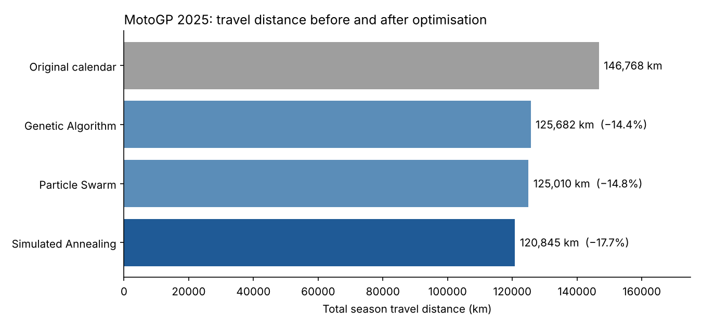

# MotoGP Calendar Optimization

This project aims to optimize the MotoGP 2025 race calendar by reducing the total distance travelled by the teams while respecting several constraints.

The optimization was done using three different algorithms:

* Simulated Annealing
* Particle Swarm Optimization
* Genetic Algorithm

The goal is to compare the three approaches and see which one can find the shortest valid calendar.



Starting from the original calendar (**146,768 km**), Simulated Annealing cuts the season's travel distance by **17.7%** while respecting every constraint.

## Objective

During a MotoGP season, teams have to travel between every circuit. The order of the races therefore has a big impact on the total distance travelled.

The main objective of this project is to find a race order that minimizes the total travel distance while respecting the following constraints:

* The temperature at each race must be between 15°C and 35°C.
* The summer shutdown must be respected.
* Mugello must remain the home race.
* Valencia must remain the final race of the season.

The distance between circuits is calculated using their geographical coordinates.

## Data

The project uses two main datasets:

* `race-weekends.csv` contains the race weekends, their weeks and temperature information.
* `track-locations.csv` contains the geographical coordinates of the circuits.

The initial calendar is used as a starting point for the optimization.

### Note about Valencia

In the provided dataset, Valencia is set on week 45. I initially expected it to be week 46 because of the way the weeks are represented, but this was not simply an indexing issue because other races would then also be shifted and the summer shutdown constraint would no longer match.

For this reason, the value from the original dataset was kept unchanged during the optimization.

## Optimization Algorithms

### Simulated Annealing

Simulated Annealing was used to optimize the calendar by swapping race weekends and evaluating the resulting travel distance.
At the beginning of the algorithm, worse solutions can still be accepted. This allows the algorithm to explore the search space and avoid getting stuck in a local optimum.
As the algorithm progresses, the probability of accepting worse solutions decreases. The algorithm then becomes more selective and converges towards a stable solution.

The best solution that respects all of the constraints found by Simulated Annealing has a total travel distance of:
**120,845.46 km**

### Particle Swarm Optimization

Particle Swarm Optimization (PSO) was also used to reduce the total travel distance.
In this implementation, a swarm of 100 particles represents different possible solutions. Each particle adjusts itself according to its own best result and the best result found by the swarm.
The algorithm was run for 1,000 iterations.

Particle Swarm Optimization found a solution that respects all of the constraints with a total travel distance of:
**125,010.43 km**

### Genetic Algorithm

The Genetic Algorithm represents each possible calendar as an individual in a population.
The population evolves through several generations using:
* Selection
* Crossover
* Mutation
The best solutions are progressively favored, allowing the algorithm to search for calendars with a shorter total travel distance while respecting the constraints.

The Genetic Algorithm found a solution that respects all of the constraints with a total travel distance of:
**125,681.86 km**

## Technologies

The project was developed in Python using:

* NumPy
* simanneal (Simulated Annealing)
* DEAP (Genetic Algorithm)
* PySwarms (Particle Swarm Optimization)
* unittest (8 unit tests on data loading, distances and constraints)

## How to run

```bash
python -m venv .venv
source .venv/bin/activate        # Windows: .venv\Scripts\activate
pip install -r requirements.txt

python calendar_optimisation.py          # Simulated Annealing (default)
python calendar_optimisation.py ga       # Genetic Algorithm
python calendar_optimisation.py pso      # Particle Swarm Optimization
python calendar_optimisation.py all      # the three algorithms
python calendar_optimisation.py test     # unit tests
```

The algorithms are stochastic: distances will vary slightly from one run to another.

## Conclusion

This project shows how different optimization algorithms can be applied to a real scheduling and logistics problem.

Simulated Annealing gave the best result in this experiment with a total travel distance of **120,845.46 km**, followed by Particle Swarm Optimization with **125,010.43 km** and the Genetic Algorithm with **125,681.86 km**.

The results also show that the different algorithms can produce different calendar structures while respecting the same constraints.
The project could be improved in the future by adding other factors such as travel costs, flight distances, travel time, carbon emissions or more detailed weather data. This would make the problem closer to a real-world logistics optimization problem.

## Author

Noé Payan

Engineering Student in Data and Artificial Intelligence

GitHub: https://github.com/NoePayan
